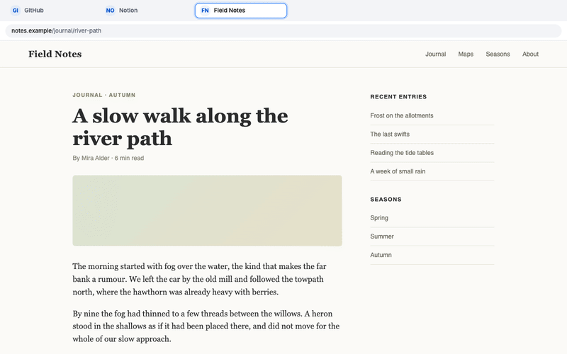

# SpeedLink 4.0

Chrome extension: hold ⌥ (Alt) and press a key to open or switch to that key's page.



Requirements live in [`docs/product-spec.md`](docs/product-spec.md), terms in [`GLOSSARY.md`](GLOSSARY.md), and contributor and agent conventions in [`AGENTS.md`](AGENTS.md).

```sh
pnpm install
pnpm dev     # watch mode
pnpm check   # lint, format and types
pnpm test    # unit tests
pnpm e2e     # build + Playwright
```

## Font

`public/fonts/inter-latin-wght.woff2` is Inter's latin-subset variable font (normal style, weight axis), copied from
`@fontsource-variable/inter@5.3.0` (`files/inter-latin-wght-normal.woff2`); its licence is `public/fonts/OFL.txt`
(SIL Open Font License 1.1). Both ship in the zip. There is no runtime dependency on fontsource. Every surface
uses it as `"SpeedLink Inter"`.

## Listing images

`pnpm listing` redraws the Store images, the extension icons, the landing page's demo loop and social card, and
`docs/media/demo.gif` from the real build. It needs `ffmpeg` and `ffprobe` on `PATH` (with libx264 and libvpx, as in
Homebrew's `ffmpeg`) to encode and check the loop. Review the results before committing them.

## Gallery

`pnpm dev`, then open `gallery.html` from the dev extension: every `KeyCap`, `KeyboardGrid`, `Monogram` and component
variant side by side, to check visuals by eye. It is never built for production.
